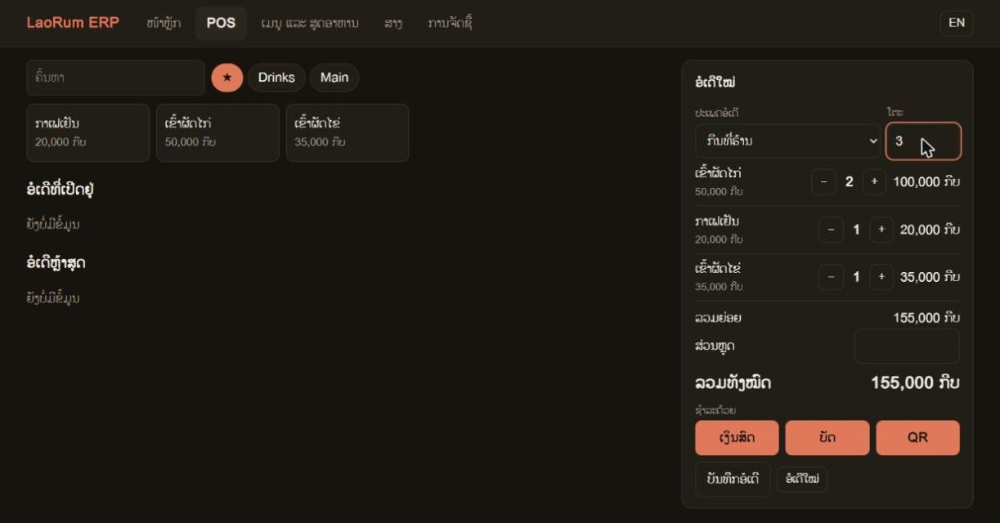

# LaoRum ERP (v1)

A single-restaurant system for **POS, menu and recipes, inventory and purchasing**, in Lao and English.
It runs on one PC in the restaurant. Staff open it in a browser on the same Wi-Fi. No internet is needed.

Requirements are in the doc "Restaurant ERP v1: Requirements (BRD and FRS)".



## Run it

You need [Node.js](https://nodejs.org) 22.5 or newer (check with `node -v`). No other installs.

1. Double-click `start.bat` (or run `npm start`).
2. On the PC, open <http://localhost:3100>.
3. On phones or other PCs on the same Wi-Fi, open the "On the team" address the window prints,
   for example `http://192.168.1.20:3100`.
4. If other devices cannot connect, allow Node.js through Windows Firewall for private networks.

First time only, to try it with sample data (7 ingredients, 3 menu items, 1 supplier):

```
npm run seed
```

To start with your own data, skip the seed. To start over, stop the server and delete the `data` folder.

## How to use it (first week)

1. **Inventory**: add every ingredient. Stock unit is what you buy in (kg, l, pcs). Recipe unit is what recipes use (g, ml). Fill "Recipe units in 1 stock unit" (1000 for kg to g). Enter the opening stock from a real count.
2. **Menu & recipes**: add each dish with its price and recipe. The screen shows recipe cost and food cost %.
3. **POS**: tap items, enter the table, pay by cash, card or QR. Stock falls by the recipe when an order is paid.
4. **Waste, staff meals, counts**: record them on the Inventory screen, always with a reason (staff meal is optional).
5. **Purchasing**: create a purchase order, a manager approves it, then "Receive goods" when the delivery arrives. Stock and ingredient cost update.

## Rules the system follows

- Stock on hand is the sum of recorded movements. It is never typed over; corrections are a count or an adjustment with a reason.
- Stock is deducted when an order is **paid**. Voiding an open order changes nothing.
- A refund removes the sale from totals but does **not** return stock (the food was cooked). Record waste if it was thrown away.
- A sale is allowed even if stock would go below zero, so service never stops. The shortfall shows as negative stock to investigate.
- Only an approved purchase order can be received.

## Your data

Everything is in one file, `data/erp.db` (SQLite). Back it up every day:

- Click **Back up data now** on the Home screen, or run `node --disable-warning=ExperimentalWarning backup.js`
  (schedule this with Windows Task Scheduler). Copies go to `data/backups` (the newest 30 are kept by the script).
- Copy `data/backups` to a USB drive or cloud folder. A backup on the same PC does not survive a dead disk.
- Home screen has CSV exports (sales, stock, stock movements, purchases) that open in Excel.

To restore: stop the server, replace `data/erp.db` with a backup file renamed to `erp.db`, start again.

## Not in v1

User logins and roles, KDS, accounting and tax reports, payroll, expiry dates, price history. Anyone on the network can use every screen, so keep the Wi-Fi private.

## For developers

```
npm test     # runs acceptance scenarios T1-T8 against an in-memory database
```

- `db.js` schema · `app.js` business rules and API · `server.js` HTTP server and static files
- `public/` browser app (plain JavaScript, no build step) · `public/i18n.js` Lao and English text
- Set `PORT` or `ERP_DB` environment variables to change the port or the database file.
